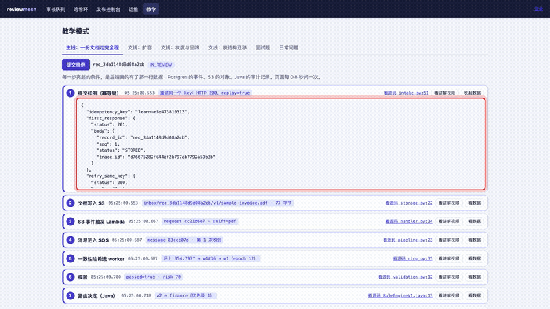
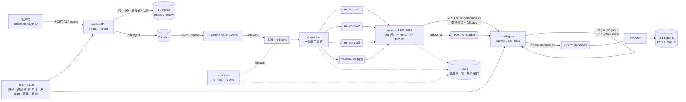

# reviewmesh

一个文档审核工作流的重建：收件、校验、按一致性哈希分区的 worker、Java 路由与人工审核队列、审计，外加 expand/contract 表迁移和按错误率自动回滚的分阶段发布；Python FastAPI + Java Spring Boot + React/TypeScript，本地用 LocalStack 4.9 跑 S3 / Lambda / SQS。



完整讲解视频：[Release learn-video](../../releases/tag/learn-video) · 分章教程：[docs/tutorial/](docs/tutorial/) · 面试题：[docs/interview.md](docs/interview.md) · 日常问题：[docs/problems.md](docs/problems.md)

## 架构



每个箭头上的消息和请求都有契约快照（[contracts/](contracts/)），两边的测试都读同一份文件。

## 怎么跑起来

```bash
./scripts/demo.sh                            # Postgres/Redis/LocalStack + bootstrap + Java + API + pipeline + 4 workers + 前端
.venv/bin/python scripts/seed_records.py 600 # 可选：给哈希环页放一些 key
open http://127.0.0.1:5189/learn             # 教学页：点「提交样例」
./scripts/stop.sh                            # 按 pid 停掉 demo.sh 起的进程
docker-compose -p reviewmesh stop            # 停容器（down -v 清数据）
```

| 服务 | 端口 |
|---|---|
| intake API（FastAPI，含 `/learn/api`、`/metrics`、`/videos`） | 8890 |
| routing-svc（Java：路由、审核队列、审计、灰度、迁移状态） | 8891 |
| worker w1–w3 / 待命的 w4（管理接口 `/state` `/join` `/leave` `/metrics`） | 8892–8895 |
| Prometheus / Grafana（可选 `--profile obs`） | 8896 / 8897 |
| 前端（Vite） | 5189 |
| Postgres / Redis / LocalStack | 54390 / 63590 / 45690 |

演示账号只在 `RM_SEED_DEMO=1` 时创建：rita（审核员）、sam（资深审核员）、olive（运维），密码是「用户名-demo」。
本地用 JDK 21 编译和运行 Java（`maven.compiler.release=17`）；Python 3.11，项目自己的 `.venv`。

## 技术选型和理由

- **幂等键落 Postgres，靠主键挡**：和业务数据同一事务提交；并发重试等对方提交后重放响应（`rmflow/intake.py`）。
- **S3 → Lambda → SQS**：文件落地这个事实驱动后续流程，收件接口不被后端拖慢；Lambda 丢事件由 reconciler 兜底。
- **一致性哈希（128 个虚拟节点）**：同一条记录固定在一个 worker 上按 seq 执行，扩容只搬约 1/(N+1)；交接期间用 Redis 锁 + fencing token。
- **路由同步 REST，交接异步 SQS**：worker 需要路由结果才能往下走；交接后不必等审核侧。
- **transactional outbox**：审核结论和下游消息原子提交。
- **Flyway + 分阶段 SQL**：`reviewer` 文本列到 `reviewer_id` 外键的五步迁移，每一步相邻两个版本并行可用；删列前有守卫。
- **纯函数的灰度控制器**：错误率窗口、最小样本数、假时钟测试回滚时限。
- **LocalStack 4.9 钉死版本**：新版需要 auth token。

## 测试

| 套件 | 命令 | 数量 | 最终验收结果 |
|---|---|---|---|
| Java（契约、审核流程、迁移并行、灰度策略） | `cd routing-svc && mvn test` | 16 | 16 passed |
| Python（单元 + 集成，独立测试库/桶/队列；含 5 条打真实栈的 `live`） | `.venv/bin/python -m pytest` | 38 | 38 passed |
| Playwright e2e（审核流程、哈希环、发布台、学习页十个阶段 + 源码链接 + 面试题 + 日常问题） | `npx playwright test` | 10 | 10 passed |
| 静态检查 | `ruff`、`mypy rmflow`、`mvn spotbugs:check`、`tsc -b` | — | 全部通过（SpotBugs 0 个问题） |
| 锚点 / 旁白 | `scripts/check_anchors.py`、`scripts/check_narration.py`、`scripts/build_problem_videos.py` | 54 个锚点 | 0 问题 |

最终验收的顺序：`docker-compose -p reviewmesh down -v` → `scripts/demo.sh`（空库从零起）→ Java 测试 → pytest → `scripts/failing-controls.sh` → e2e。

### 能失败的对照

`scripts/failing-controls.sh` 对每个保护关一次、开一次（原始输出 `docs/results/failing-controls.txt`）：

| 关掉的保护 | 测试 | 关掉时（真实输出） | 打开时 |
|---|---|---|---|
| `no_idempotency` 幂等键 | `test_concurrent_retries_create_exactly_one_record` | `AssertionError: 8 records for one idempotency key` | 1 passed |
| `modulo_hash` 一致性哈希换成取模 | `test_scale_out_moves_about_one_over_n_plus_one` | `AssertionError: moved 75.38% of keys, expected about 25%` | 1 passed |
| `no_order_gate` 分区内顺序闸门 | `test_steps_apply_in_seq_order_even_when_delivered_shuffled` | `assert [5, 2, 6, 1, 3, 4, ...] == [1, 2, 3, 4, 5, 6]` | 1 passed |
| `no_lock` 交接期的记录锁 | `test_two_owners_during_a_handoff_never_overlap_on_one_record` | `assert 2 == 1`（同一时刻两个 worker 在同一条记录里） | 1 passed |
| `no_rollback` 自动回滚（Java） | `RolloutPolicyTest.errorRegressionRollsBackToZeroWithinFiveSeconds` | `fault at 3000 ms, never rolled back` / `Failures: 1` | `rolled back at 3500 ms (500 ms later)`，BUILD SUCCESS |

```text
all 5 controls: red with the protection off, green with it on
```

## 仓库实测指标

所有数字都能用仓库里的命令重跑；测量环境是本机 colima（4 核 / 6 GiB，与其他几个项目共享）。延迟类的数字只说明链路，不作为性能结论。

**扩容时搬走的 key 比例**（`scripts/ring_bench.py`，纯计算，五组各两万个随机 id 的中位数，`docs/results/ring-bench.md`）：

| N → N+1 | 理想 1/(N+1) | 环，128 虚拟节点 | 环，256 虚拟节点 | hash % N |
|---|---|---|---|---|
| 2 → 3 | 0.333 | 0.317 | 0.337 | 0.667 |
| 3 → 4 | 0.250 | 0.277 | 0.253 | 0.751 |
| 4 → 5 | 0.200 | 0.175 | 0.193 | 0.800 |
| 8 → 9 | 0.111 | 0.103 | 0.105 | 0.889 |

在跑着的系统上点一次扩容（3 → 4，演示库里的真实 record id）：605 个 key 搬走 170 个，**0.281**，全部搬给新加入的 w4。负载均匀度：128 个虚拟节点、4 台时 max/min = 1.24。

**自动回滚**：假时钟单测里故障注入后 0.5 秒回到 0%；在跑着的系统上（10% 放量、100 rps dry-run 流量、注入四成故障）连跑五次：0.3 / 0.6 / 0.9 / 0.9 / 1.6 秒，**中位数 0.9 秒**。触发时窗口错误率 5.3%–12.5%（窗口里还有故障前的成功请求）。

**查询路径**（`scripts/explain_paths.py`，两万行任务/记录 + 十万条事件，`docs/results/explain.md`）：reconciler、时间线、审核队列、审计四条查询都走各自设计的索引，计划里没有 Seq Scan。

**expand/contract**：演示库上实走一遍：V2 + DUAL_WRITE → 回填 `{"updated":1,"remaining":1}`、`{"updated":1,"remaining":0}` → NEW_ONLY + V3；提前删列那次被守卫拦下（`contract blocked: 2 review_tasks rows are not backfilled`）。

**容器内存**（全部测试跑完后，`docker stats`）：LocalStack 208 MiB、Lambda 运行容器 100 MiB、Postgres 96 MiB、Redis 6 MiB，合计约 410 MiB。

## What this is not / 局限

- 不是性能基准：没有做压测，没有吞吐数字。
- 灰度的滑动窗口在 Java 进程内存里，多实例时要放进共享存储或指标系统。
- fencing token 由 Redis `INCR` 生成；Redis 丢数据时 token 会回退（会被库里更大的 fence 拒绝，但需要人工处理）。
- DLQ 只能看（运维页、告警），没有一键重放。
- JWT 是共享 HS256 密钥，默认值是明显的本地占位；生产应换成 KMS/Secrets Manager 和真正的身份服务。
- Lambda 部署用 boto3 脚本（`rmflow/bootstrap.py`），不是 IaC。
- CI（`.github/workflows/ci.yml`）写好了，但这个仓库还没推到 GitHub，CI 从没在 GitHub 上跑过；本地等价命令都跑通了。
- 简历里的数字是在公司里的结果，这里一个都没写；面试题「简历对应」一节说明了怎么分开讲。

## 其他文档

- [docs/tutorial/](docs/tutorial/)：八章，每章对应一个 git tag（`step-01` … `step-08`）
- [docs/ai-dev-verification.md](docs/ai-dev-verification.md)：AI 辅助开发怎么验证
- [docs/results/](docs/results/)：环基准、EXPLAIN 计划、失败对照的原始输出

## License

MIT
